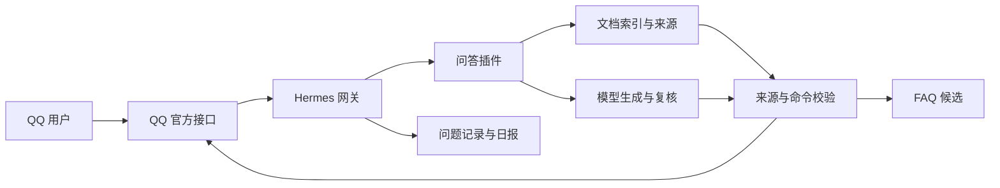

# 架构与边界

## 1. 推荐路径以 Hermes 接收消息

正式路径将 QQ 消息传入 Hermes，再由本项目插件执行独立检索与答复校验。模型通过配置的 API 工作，能够使用远端提供者或由部署者准备的兼容服务。

接口补丁针对 [锁定的 Hermes 提交](../patches/hermes-lock.json)。补丁覆盖本实现需要的 QQ 接入点；未验证的上游升级不属于当前兼容承诺。

## 2. 模块分工

| 目录 | 职责 |
| --- | --- |
| `cie-qq-ops/` | 文档同步、检索、模型调用、提取与校验、用户环境、FAQ 与日报 |
| `plugins/` | 公开的 Hermes 插件与配置入口 |
| `patches/` | Hermes 兼容提交、必要补丁与上游许可 |
| `qq-support-bot/` | 可选独立基础模块、文档处理和命令行入口 |
| `scripts/` | 环境准备、安装、诊断、离线演示与发布检查 |
| `examples/` | 空白凭据与配置示例 |
| `tests/` | 脱离维护者机器运行的接入和工具测试 |

## 3. 独立模块是另一条运行路径

`qq-support-bot` 能直接使用官方 SDK 和配置的本地模型接口提供基础问答。其状态、指令、超时和日报调度与 Hermes 路径分别实现；不能将主路径的所有检修结果推广到独立模块。

默认离线示例只验证仓库内部流程。NapCat 模拟用户登录和 Codex 自动询问不属于正式机器人必需依赖，也不在公开安装中自动启动。

## 4. 来源和数据边界

问答以检索到的原文为证据。来源类型、适用板型、版本与教程范围影响答案；校验引用存在仍不能充分证明任意自然语言推断。受限规则只覆盖已知类别，不能承诺所有问法准确。

运行数据库和模型凭据属于部署者。公开代码与运行数据分开，文档同步由使用者主动执行。FAQ 发布及日报投递是外部动作，不由安装工具默认启用。

## 5. 连接恢复改善故障后的恢复

ACK 表示服务器对心跳的确认。连接恢复模块在上一轮心跳未确认时更换连接，并沿用上游 Resume 或重新 Identify 的流程；写入也有界限。

这能缩短坏连接上的等待，不能根除网络、NAT、防火墙或远端节点造成的 TCP 停滞。恢复连接也不等于每一条历史消息都已重新投递。部署者仍需按实际消息与回执验证可用性。
